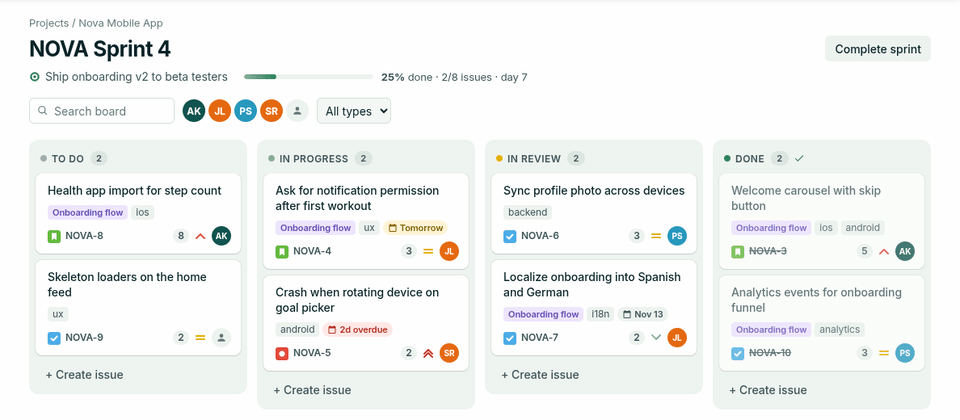
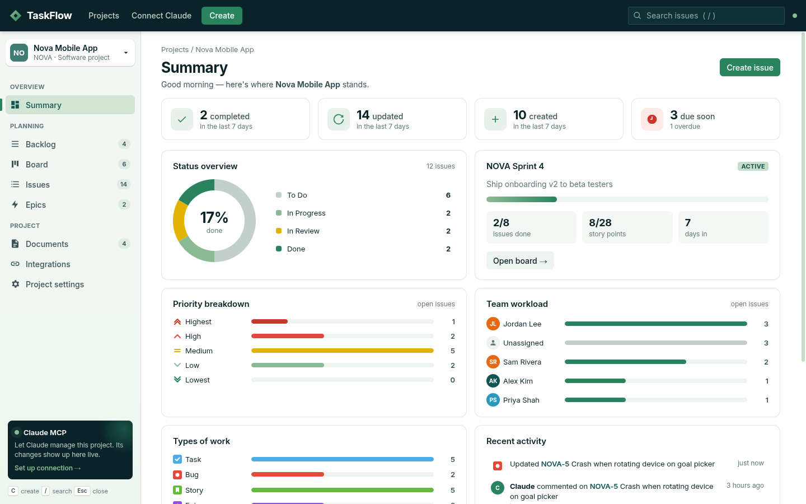
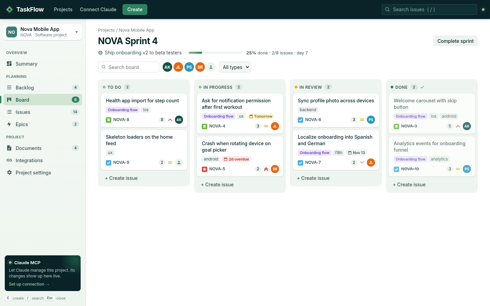
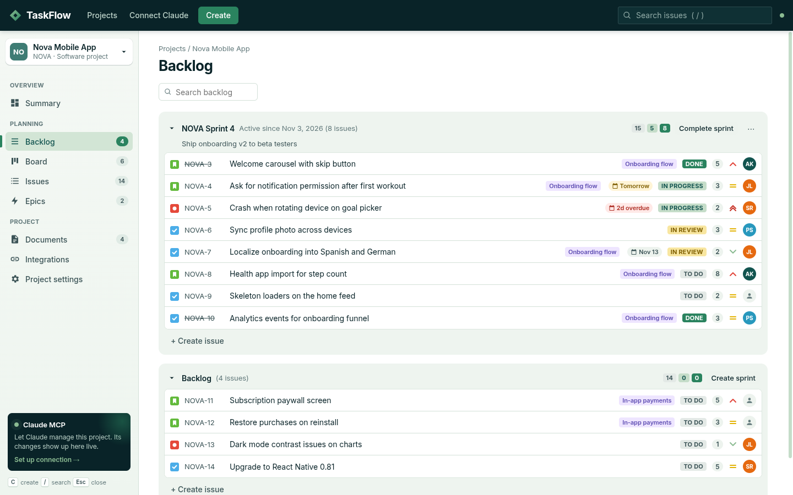
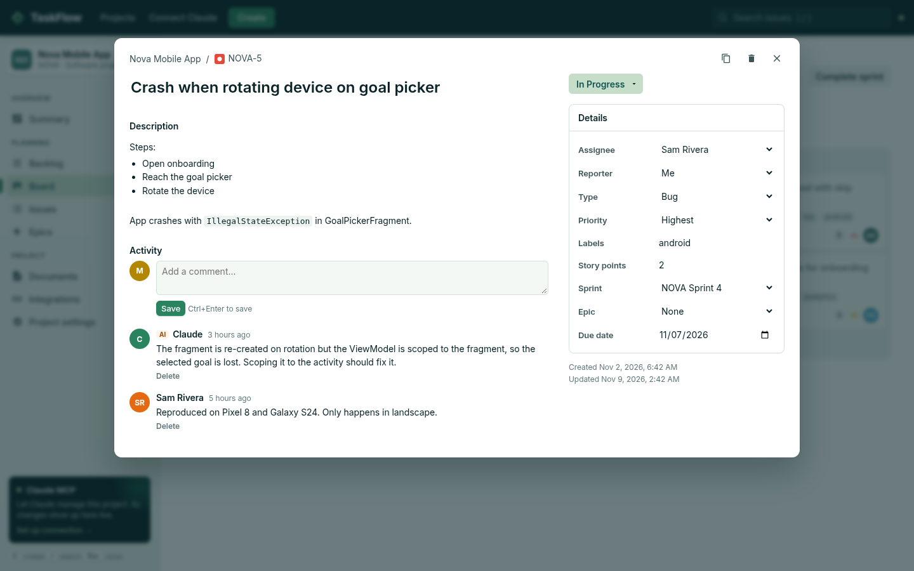
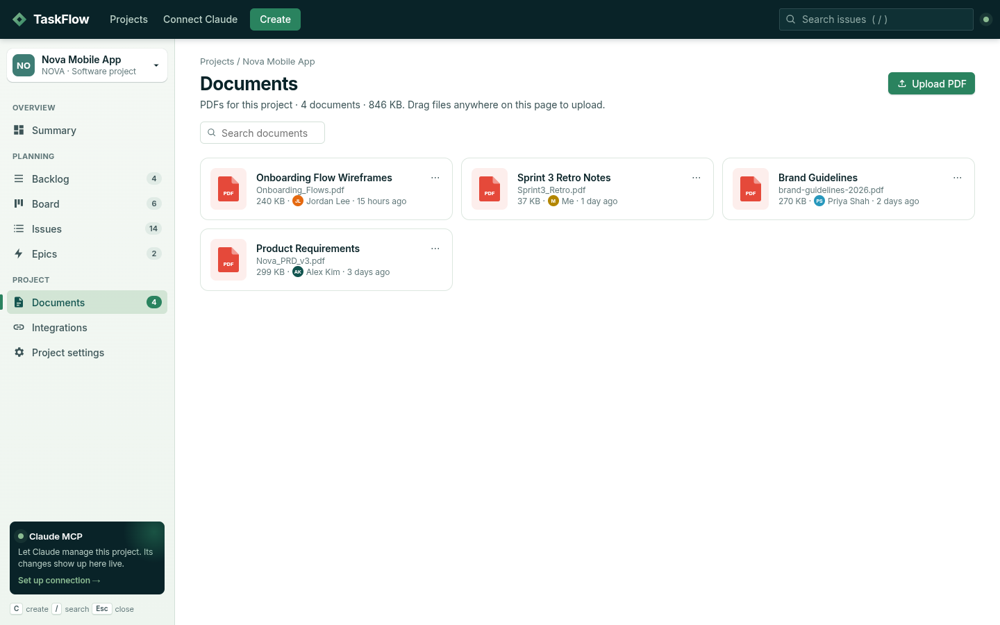
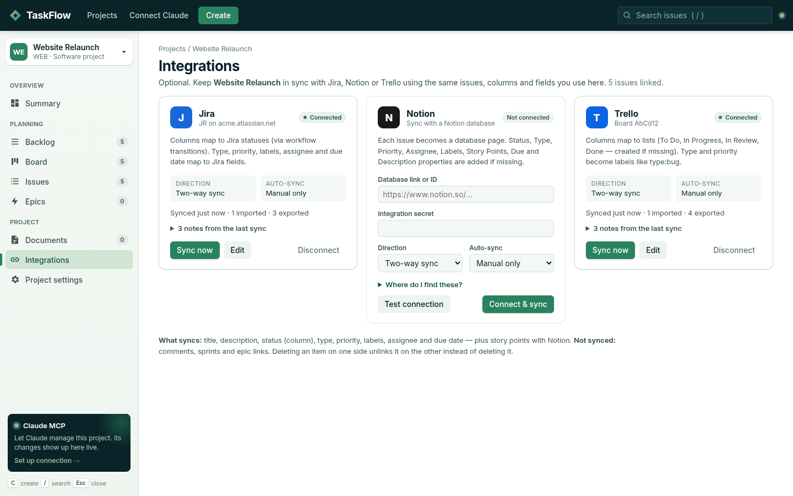

# TaskFlow

A Jira-style task management desktop app (Electron) with a built-in **MCP server**, so Claude can read and manage your projects, issues and sprints. Changes Claude makes show up in the app live.



*Claude creates an issue and moves two others through the MCP server; the open board updates on its own.*

## Screenshots

| | |
|---|---|
|  **Summary**: counts, status, sprint progress, workload and activity |  **Board**: sprint columns with drag and drop, due dates and filters |
|  **Backlog**: plan sprints and drag issues between them |  **Issue detail**: editable fields and comments, including Claude's |
|  **Documents**: named PDFs per project |  **Integrations**: optional Jira, Notion and Trello sync |

*All screenshots use made-up demo data.*

## Run

```bash
npm install
npm start            # on Linux, if Electron complains about the sandbox: npm run start:nosandbox
```

## Features

- **Projects** with keys (`WEB-1`, `WEB-2`, …)
- **Board**: Kanban columns (To Do / In Progress / In Review / Done), drag and drop, filters by text, assignee and type
- **Backlog**: sprints you can create, start and complete, drag issues between sprints and the backlog, quick inline create
- **Issues**: sortable, filterable table of every issue
- **Epics**: epic progress plus child issues
- **Issue detail**: inline-editable title and description (basic markdown), status, assignee, reporter, type, priority, labels, story points, sprint, epic, due date, comments
- **Documents**: upload PDFs to a project (button or drag and drop) and give each one a name; open, rename, show in folder or delete. Files are copied into `~/.taskflow/files/`
- Global search (`/`), create shortcut (`C`)

## Integrations: Jira, Notion, Trello (optional)

Each project can sync with any of the three services. Open **Integrations** in the project sidebar, enter your credentials and click **Connect & sync**.

| Service | Syncs with | Columns map to | Credentials |
|---|---|---|---|
| Jira | a Jira Cloud project | Jira statuses (via workflow transitions) | site, email, [API token](https://id.atlassian.com/manage-profile/security/api-tokens), project key |
| Notion | a database (missing properties are added) | a Status property | [integration secret](https://www.notion.so/profile/integrations) + database link (share the database with the integration) |
| Trello | a board | lists (To Do / In Progress / In Review / Done, created if missing) | [API key + token](https://trello.com/power-ups/admin) + board link |

- **What syncs:** title, description, status, type, priority, labels, assignee and due date, plus story points with Notion. On Trello, type and priority are stored as labels like `type:bug` and `priority:high`.
- **Not synced:** comments, sprints, epic links.
- **Direction:** two-way (default), or one-way in either direction. Two-way merges field by field: if only one side changed a field, that change wins; if both did, the most recent edit wins.
- **Deletes are safe:** deleting an item on one side unlinks it instead of deleting it on the other.
- **When:** manual **Sync now**, or auto-sync every 5, 15 or 60 minutes while the app is open.
- **Credentials:** stored in `~/.taskflow/integrations.json` (file mode 600), encrypted with your OS keyring when available. Syncing runs only in the desktop app, so the MCP server never sees your API keys.

## Connect to Claude (MCP)

The in-app **Connect Claude** page shows the exact command and config for your machine.

**Claude Code**
```bash
claude mcp add taskflow --scope user -- node /absolute/path/to/task-managment-app/mcp/server.js
```

**Claude Desktop**: add this to `claude_desktop_config.json`, then restart:
```json
{ "mcpServers": { "taskflow": { "command": "node", "args": ["/absolute/path/to/task-managment-app/mcp/server.js"] } } }
```
If Claude Desktop can't find `node`, use its absolute path (run `which node` to find it).

### Tools
`list_projects`, `create_project`, `list_issues`, `get_issue`, `create_issue`, `update_issue`, `transition_issue`, `assign_issue`, `add_comment`, `delete_issue`, `get_board`, `list_sprints`, `create_sprint`, `start_sprint`, `complete_sprint`, `move_to_sprint`, `list_users`, `add_user`, `remove_user`, `list_documents`, `add_document`

The MCP server works whether or not the app is open.

## How it fits together

```
Electron app ──┐
               ├──> ~/.taskflow/data.json  (atomic writes + lock file)
MCP server  ───┘    app watches the file, so it re-renders live
```

- `src/store.js`: shared data layer, used by both processes
- `src/main.js`, `src/preload.js`: Electron main process and IPC bridge
- `src/renderer/`: UI (vanilla JS, no build step)
- `mcp/server.js`: MCP stdio server

Set `TASKFLOW_DATA_DIR` to use a different data folder.

## Scripts

- `npm run test:mcp`: end-to-end test of every MCP tool against a temporary data folder
- `npm run test:sync`: tests the sync engine and all three connectors against in-memory fakes of the Jira, Notion and Trello APIs
- `npm test`: runs both
- `npm run dist`: build installers with electron-builder (AppImage/deb, dmg, nsis)
